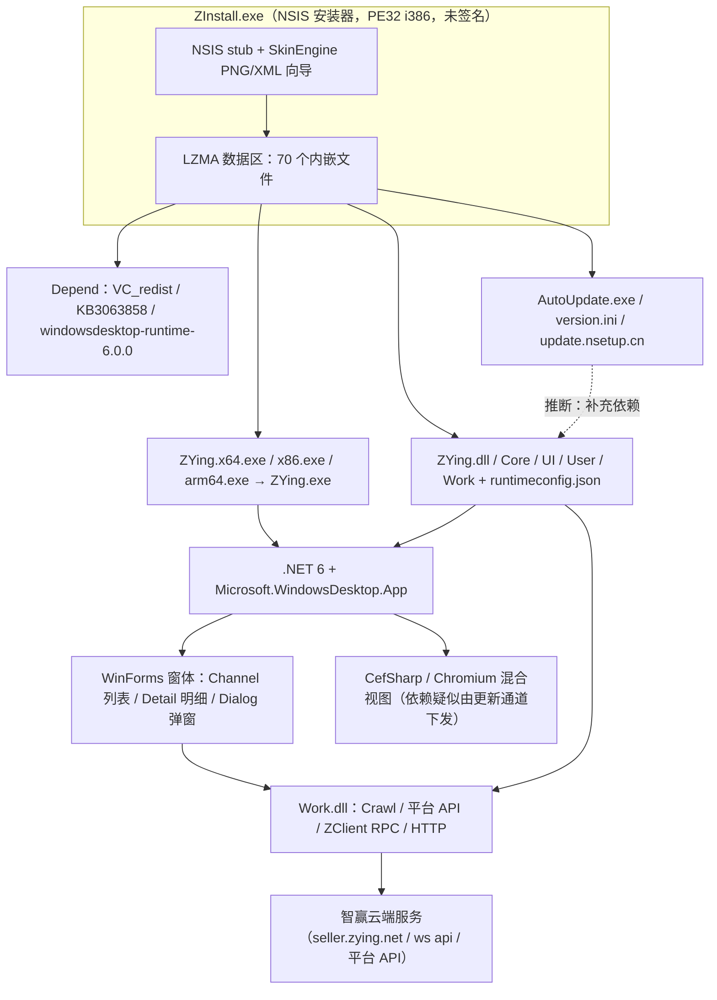

# 01 安装包与技术架构

> 研究对象：`E:/程序项目/UNA-SELLES/分析材料/智赢ERP/ZInstall.exe`
> 研究日期：2026-11-15
> 方法：**纯静态分析 + REA（rea-agents）定向元数据观察**，未运行安装程序、未运行 ERP 客户端、未抓包。
> 配套：`02_商品采集库与数据流.md`、`03_商品编辑与刊登流程.md`、`04_客户端模块与通信架构.md`、`05_UnaSeller可借鉴功能清单.md`、`06_证据索引与未确认项.md`
> 引用已有报告：`分析材料/逆向文档/01_亚马逊商品采集功能分析.md`、`02_插件运行流程.md`、`03_跨境ERP助手_采集链路与对比.md`

---

## 0. 证据等级约定

| 标记 | 含义 |
|---|---|
| **OBSERVED** | 由静态文件、PE 结构、字符串、资源或 REA 元数据直接支持 |
| **INFERRED** | 依据命名、调用关系、结构或业务需求推断，未被直接证明 |
| **UNKNOWN** | 证据不足，无法确认 |
| **RUNTIME_VERIFIED** | 受控运行验证 —— **本报告没有任何此类结论** |

REA 的 Evidence 均为 `shipped-artifact` 静态观察，`confidence` 为 `observed` / `derived`；本文的 INFERRED 不等于 REA 的 `inferred` 断言。

---

## 1. 结论速览

| # | 结论 | 等级 |
|---|---|---|
| 1 | `ZInstall.exe` 是 **NSIS 安装包/安装引导**，不是 ERP 主程序本体 | **OBSERVED** |
| 2 | 客户端为 **.NET 6 Windows Desktop（WinForms）+ CefSharp/Chromium 混合 UI**，不是 Electron | **OBSERVED**（框架）/ **INFERRED**（UI 具体组合） |
| 3 | 安装后主程序是架构对应的原生宿主 `ZYing.exe`（由 x64/x86/arm64 三选一复制），业务代码集中在 5 个托管 DLL | **OBSERVED** |
| 4 | 界面资源是 **.NET 程序集内嵌资源 + PNG 皮肤 + XML 安装向导**，不是随包发布的 HTML/CSS/JS 前端工程 | **OBSERVED** |
| 5 | 安装包内 **没有** libcef / CefSharp 程序集二进制、也 **没有** 本地商品数据库引擎 | **OBSERVED**（未发现）/ **INFERRED**（依赖由更新通道分发） |
| 6 | 业务逻辑大量在客户端（爬虫、平台 API、图片处理），但**商品主数据由服务端持有** | **INFERRED**，见 `02`/`04` |
| 7 | 原始 EXE 无 Authenticode 数字签名 | **OBSERVED** |
| 8 | 本轮未找到任何「插件 ↔ EXE 本地 IPC」证据 | **OBSERVED**（未发现）/ **UNKNOWN**（运行时是否存在） |

---

## 2. 目标文件档案

### 2.1 基础信息（PowerShell `VersionInfo` / `Get-FileHash` / `Get-AuthenticodeSignature` 复核）

| 项 | 值 |
|---|---|
| 文件名 | `ZInstall.exe` |
| 大小 | 13,509,862 字节 |
| SHA256 | `847f72287ea7379b2f13ec6f06eb198ab342393615c4b818f3cc261aaa7613a8` |
| FileVersion | 4.0.1.0 |
| ProductVersion | 1.0.1.1 |
| ProductName | 智赢跨境 |
| CompanyName | 杭州智赢科技有限公司 |
| FileDescription | 智赢跨境安装程序 |
| LegalCopyright | (C) 2021 ZYing All Rights Reserved. |
| Language | 简体中文(中国大陆) |
| Authenticode | **NotSigned**（`SignatureType = None`，`HasSignature = False`） |
| PE 类型 | PE32 / i386 |
| PE 时间戳 | 2021-07-01 07:14:51 UTC |
| Overlay | 13,424,358 字节，占整文件约 **99.4%** |

> **合规备注**：文件未签名这一点只作为「文件基本信息」记录，不用于任何完整性绕过、签名伪造或授权相关操作。

### 2.2 安装包类型判定

对 PE 节表末尾之后的 overlay 做头部观察：

```text
overlay[0x00..0x03] = ef be ad de        # NSIS firstheader 魔数
overlay[0x04..]     = "NullsoftInst"     # NSIS 标志
```

同时解压出的 NSIS 脚本头中直接出现：

```text
Nullsoft Install System v01-Jul-2021.cvs
nsSkinEngine.dll / NSISInitSkinEngine / NSISRunSkinEngine
nsExec.dll / System.dll / nsProcess.dll / ShellLink.dll / nsUtils.dll
nsAutoUpdate.dll / nsStatistics.dll / SelfDel.dll / effect.dll
\ZYing\ZYingStep\Install\Install1.0.1.1.dat
```

**OBSERVED**：`ZInstall.exe` 是带自绘皮肤（SkinEngine）和自动更新插件的 NSIS 安装器。
**OBSERVED**：`FileDescription = 智赢跨境安装程序`、ProductVersion `1.0.1.1` 与脚本头里的版本目录 `\1.0.1.1` 一致。
**UNKNOWN**：是否为「在线下载器 + 后续全量包」的两段式安装，需运行时观察更新通道才能确认。

---

## 3. 非执行式提取（未运行安装程序）

### 3.1 方法与约束

| 项 | 说明 |
|---|---|
| 原件 | 只读；未修改、未覆盖、未执行 |
| 临时目录 | `C:\Users\ASUS\AppData\Local\Temp\zying-rea-20261115\` |
| 只读副本 | `ZInstall_copy.exe`，SHA256 与原件一致 |
| 提取方式 | Python 手工解析 PE → 定位 overlay → LZMA `FORMAT_RAW` / `FILTER_LZMA1`（dict 32 MiB, lc=3, lp=0, pb=2）先解脚本头，再循环解内嵌文件块 |
| 脚本头 | 解出 184,434 字节 → `nsis_header.bin` / `nsis_header_strings.txt` |
| 数据区 | `nsis_after_header.bin` = 13,413,876 字节 |
| 结果 | **70 个内嵌文件**；消耗 13,413,868 字节，尾部剩余 8 字节（填充/校验） |
| 清单 | `extract_manifest.txt`（索引、偏移、压缩大小、解压大小、文件类型） |

> 采用「非执行式提取」是任务书的明确要求：整个过程只读取字节、不启动 NSIS、不写系统目录。

### 3.2 载荷分类统计

| 类型 | 数量 | 索引范围 | 说明 |
|---|---:|---|---|
| PE 文件 | 19 | 0–4、55–63、65–69 | 安装插件、宿主 EXE、托管 DLL、卸载器 |
| PNG | 46 | 7–30、33–54 | 自绘安装向导皮肤 |
| XML | 4 | 5–6（带 UTF-8 BOM）、31–32 | `Install_*.xml` / `MessageBox_*.xml` 向导文案 |
| JSON | 1 | 64 | `ZYing.runtimeconfig.json` |
| **合计** | **70** | | 与 NSIS 数据区末尾吻合 |

### 3.3 已识别文件映射（按脚本头中的目标文件名）

| 提取文件 | 大小（解压后） | 名称 / 判定 | 依据 |
|---|---:|---|---|
| `f057.bin` | 844,800 | `ZYing.Core.dll` | 脚本头 `InstallFiles` 清单 + REA 元数据 |
| `f058.bin` | 2,233,856 | `ZYing.UI.dll` | 同上 |
| `f059.bin` | 17,701,888 | `ZYing.User.dll` | 同上 |
| `f060.bin` | 8,429,056 | `ZYing.Work.dll` | 同上 |
| `f061.bin` | 432,640 | `ZYing.arm64.exe` | 同上 |
| `f062.bin` | 344,064 | `ZYing.dll` | 同上 |
| `f063.bin` | 437,248 | `ZYing.x64.exe` | 同上 |
| `f064.bin` | 372 | `ZYing.runtimeconfig.json` | 文件内容 |
| `f065.bin` | 403,456 | `ZYing.x86.exe` | 同上 |
| `f066.bin` | 1,374,064 | NSIS `exehead` 型 PE（**推断为 `uninst.exe` 卸载器**） | 内嵌 manifest `Nullsoft.NSIS.exehead` |
| `f067.bin` | 4,608 | `ShellLink.dll` | 内嵌字符串 |
| `f069.bin` | 5,120 | `selfdel.dll` | 内嵌字符串 |
| `f002/f003/f004/f056` | 6,656 / 11,776 / 115,712 / 93,184 | `nsExec.dll` / `System.dll` / `UiFeatureEffect.dll` / `nsProcess.dll` | 内嵌字符串 |
| `f000/f001/f055/f068` | 661,504 / 1,799,680 / 170,496 / 1,441,280 | 安装期 PE，**具体名称 UNKNOWN** | 未逐一命名 |
| `f005/f006/f031/f032` | 7,225 / 7,244 / 2,764 / 2,786 | 安装向导 XML（中/英） | 脚本头列出 `Install_zh-CN.xml` 等 4 个文件名 → **INFERRED** 对应 |

### 3.4 运行框架的直接证据

`f064` → `named/ZYing.runtimeconfig.json`：

```json
{
  "runtimeOptions": {
    "tfm": "net6.0",
    "frameworks": [
      { "name": "Microsoft.NETCore.App", "version": "6.0.0" },
      { "name": "Microsoft.WindowsDesktop.App", "version": "6.0.0" }
    ],
    "configProperties": {
      "System.Reflection.Metadata.MetadataUpdater.IsSupported": false
    }
  }
}
```

**OBSERVED**：目标运行时为 .NET 6 + Windows Desktop（WinForms/WPF 应用域）。
REA `inspect_managed_artifact` 对 `ZYing.User.dll` / `ZYing.Work.dll` 均报告 `target_frameworks = [".NETCoreApp,Version=v6.0"]`，与 runtimeconfig 一致。

---

## 4. 安装后目录、启动方式与依赖（脚本头静态观察）

```text
C:\Program Files\ZYing\                       # 安装根
  \1.0.1.1\                                  # 版本目录
    ZYing.exe                               # 实际启动入口
    ZYing.x64.exe / ZYing.x86.exe / ZYing.arm64.exe
    ZYing.dll / ZYing.Core.dll / ZYing.UI.dll / ZYing.User.dll / ZYing.Work.dll
    ZYing.runtimeconfig.json
    version.ini / AutoUpdate.exe
  \ZYing\ZYingStep\Install\                  # 皮肤资源与 Install1.0.1.1.dat
  \uninst.exe
```

脚本头直接可见的字符串与含义：

| 字符串 | 含义 | 等级 |
|---|---|---|
| `\ZYing.x64.exe->\ZYing.exe`、`\ZYing.x86.exe->\ZYing.exe` | 安装时按 CPU 架构把对应原生宿主复制/重命名为 `ZYing.exe` | **OBSERVED**（字符串）/ **INFERRED**（复制行为） |
| `kernel32::IsWow64Process2` / `IsWow64Process` | 架构判定 | **OBSERVED** |
| `Depend\windowsdesktop-runtime-6.0.0-win.exe /quiet /norestart` | 静默安装 .NET 6 Desktop Runtime | **OBSERVED** |
| `Depend\VC_redist.exe /quiet /norestart`、`KB3063858.msu` | 安装 VC++ 运行库与系统补丁 | **OBSERVED** |
| `http://websys.oss-cn-shenzhen.aliyuncs.com/runtime/...` | 依赖缺失时从对象存储下载 x86/x64 运行库 | **OBSERVED**（仅记录用途与域名） |
| `AddOneDownloadFileTask`、`https://update.nsetup.cn` | 更新服务与下载任务 | **OBSERVED** |
| `SOFTWARE\ZYing`、`Software\Microsoft\Windows\CurrentVersion\Uninstall\ZYing`、`App Paths\ZYing.exe`、`...\Run` | 注册表项、卸载项、开机自启 | **OBSERVED** |
| `GetMachineCodeInfo` / `MachineCode` / `src_channel` / `channelid` | 安装期设备与渠道统计（**只记录边界，不展开、不复用**） | **OBSERVED** |
| 更新服务配置标识（值不输出） | `SetAppServerSettings` 的配置项，**仅记录存在性，不输出明文、不复用** | **OBSERVED**（存在性） |

**UNKNOWN**：更新通道实际下发哪些文件、版本目录完整清单、是否下发 CEF 运行时。

---

## 5. 客户端技术栈与 UI 形态

### 5.1 分层

| 程序集 | SHA256 | 大小 | 作用（REA + 字符串证据） |
|---|---|---:|---|
| `ZYing.dll` | `2a859f546488878b39f53baaf5b6d5c63911d308888990ddec6b7b12b43f7dec` | 344,064 | 入口与资源，含「跨境 ERP 系统」 |
| `ZYing.Core.dll` | `bcd091f02f4990d5a9734a4caea132ed6443f6353d918ad71adc564ea5244909` | 844,800 | 基础库：HTTP、JSON 配置、KV/文件缓存、图片与 OSS、翻译 |
| `ZYing.UI.dll` | `10ae3c786f2a6e1c5b7bd8cb072a2fa9d0c746f6de42e40bb475d26e212dc838` | 2,233,856 | 表格/图像控件、Win32 控件消息、ReoGrid、HTML 控件接口 |
| `ZYing.User.dll` | `12430c39ee81c58fe7753a540017b1816a39d730c761033c816865dfd2e1cbf9` | 17,701,888 | **业务窗体主集合**：采集库、草稿、刊登、店铺、订单/客服等 |
| `ZYing.Work.dll` | `33d0ff00dd7d95fd7ab949508e8b696090f65a693a3c4c06b7730a468978f8db` | 8,429,056 | 爬虫、平台 API、CEF、RPC/HTTP/WebSocket、Mercado Libre / Amazon / eBay 等 |

REA `inspect_managed_artifact` 摘要：

```text
ZYing.User.dll : TypeDef 9410 / Field 45200 / MethodDef 61468 / ManifestResource 1043   (metadata partial)
ZYing.Work.dll : TypeDef 5561 / Field 23623 / MethodDef 34769 / ManifestResource 24     (metadata partial)
ZYing.Core.dll : TypeDef  460 / Field  2131 / MethodDef  4699  / MVID 2d0b341e-...      (metadata complete)
```

### 5.2 UI 框架

**OBSERVED** 字符串/类型证据：

- `CefSharp.WinForms.ChromiumWebBrowser`、`CefSharp.Handler`、`CefSharp.WinForms`、`CefSharp.Core`、`CefSharp.IResponseFilter`、`CefSharp.JavascriptBinding`、`ZYing.Cef`、`ResourceRequestHandler`、`GetCachePath`、`ClearBrowserCache`（`ZYing.Work.dll` / `ZYing.User.dll`）。
- `ZYing.Dialog.CefBroswerForm`、`ZYing.Dialog.CefPdfPrintForm`、`ZYing.UI.EBrowser`、`ZYing.UI.Explorer`（`ZYing.User.dll` / `ZYing.Work.dll`）。
- `IHTMLFramesCollection2`、`LVM_GETITEMTEXTA` / `LVM_SETITEMTEXTA`、`toolStripMenuItem1`（`ZYing.UI.dll`）→ WinForms + 部分 MSHTML/ListView 互操作。
- `ZYing.Channel.*`（64 个类型，列表/渠道页）、`ZYing.Detail.*`（55 个，明细页）、`ZYing.Dialog.*`（53 个，弹窗）构成「列表 → 明细 → 对话框」三级页面组织。

**OBSERVED**：不是 Electron（无 `app.asar`、无 Electron 运行时、无前端 bundle）。
**OBSERVED**：安装包内 **未发现** `libcef.dll` / `chrome_elf.dll` / `icudtl.dat` / `CefSharp*.dll` 二进制；只在 `ZYing.User.dll` / `ZYing.Work.dll` 里看到对 CefSharp 的引用字符串。
**INFERRED**：CEF 运行时由更新通道或既有安装目录提供，而非 `ZInstall.exe` 自带。
**OBSERVED**：不存在随包发布的 `index.html` / React / Vue 前端资源；`ZYing.Work.dll` 中的 `ZYing.Web.Js.XdScript`、`ZYing.Web.Js` 是**注入到被采集页面里执行的页面自动化脚本**，不是客户端界面资源。

### 5.3 业务逻辑位置

| 层 | 客户端证据 | 判断 |
|---|---|---|
| 采集/页面解析 | `ZYing.Crawl.SpiderBase` / `SpData` / `SpThumb` / `SpStock`、`GetHtmlAsync` / `EvaluateScriptAsPromiseAsync` / `GetCookies` | **OBSERVED** 客户端自带 CEF 采集器 |
| 平台 API | `ZYing.Mercadolibre`、`MeliAuth`、`GetCatalogItem`、`SearchCatalogItems`、`api.mercadolibre.com`、`api.ebay.com` | **OBSERVED** 客户端有平台调用代码 |
| 图片/翻译 | `ZYing.Web.AliImage` / `Baidu` / `Google`、`ImageURL` / `ImageBase64`、OSS 域名 | **OBSERVED** |
| 商品主数据 | 无本地 DB 引擎；`ZClient` / `Zrpc` / `HttpClientEx` / `/ws/api.dll` / `/wsapi` | **INFERRED** 服务端持有，见 `04` |

---

## 6. 架构总览（Mermaid）



---

## 7. 本阶段限制与未确认项

| 项 | 原因 | 影响 |
|---|---|---|
| `ZYing.User.dll` 无法做 REA 成员级反编译 | REA 报告 `Managed metadata exceeds the 67108864 byte representation budget`，`coverage.state = unavailable` | 采集库 UI 的方法级调用链改用字符串/资源/类名证据，标记 INFERRED |
| `ZYing.Work.dll` 元数据为 `partial` | `Module` / `Assembly` 表各有 2 行、`#GUID` 堆索引越界（疑为加壳/混淆） | 类型/方法观察有效，但不宣称全量覆盖 |
| 未运行安装程序与客户端 | 任务书限定静态分析 | 无 `RUNTIME_VERIFIED`；安装后真实目录、更新下发内容、CEF 依赖均 UNKNOWN |
| 未发现 CEF 二进制 / 本地 DB 引擎 | 全 70 个载荷二进制扫描 | 只能说明「不在此安装包内」，不能证明「运行时不存在」 |

---

## 8. 与后续报告的接口

- `02` 回答「商品数据到底存在哪里」，使用本文的 `ZClient` / 缓存 / 无本地 DB 结论。
- `03` 使用 `ZYing.User.dll` 的中文资源与 `ZYing.Detail.*` / `ZYing.Channel.*` 类型索引。
- `04` 展开 `ZClient` / `Zrpc` / `HttpClientEx` / `KeyValueCache` / `IO.Cache` 的 REA 方法级证据。
- `06` 给出全部 Evidence ID、文件哈希与待验证清单。
