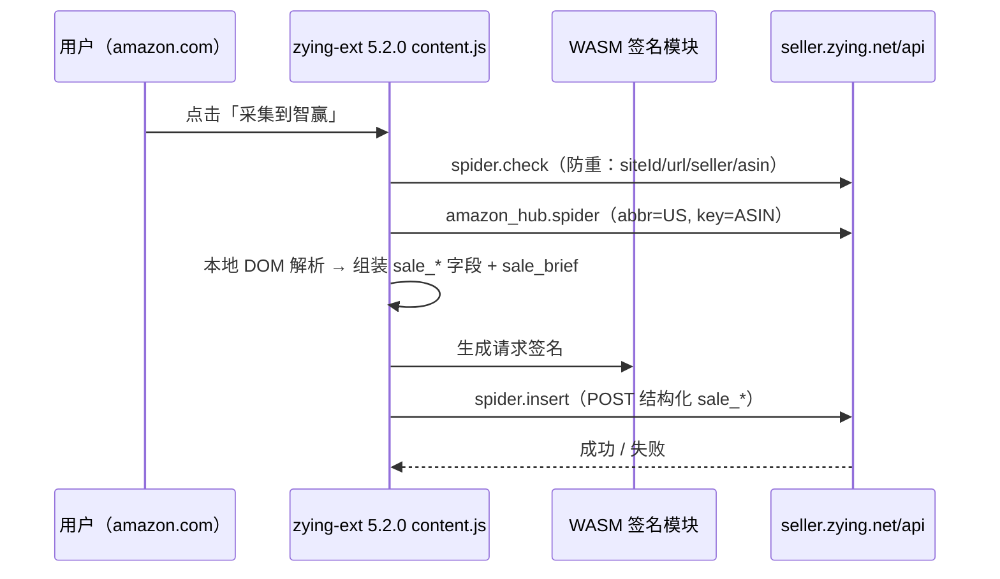
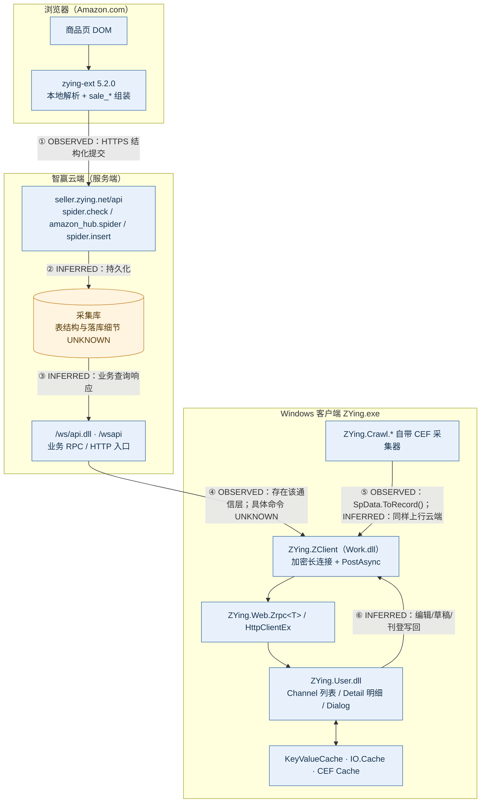
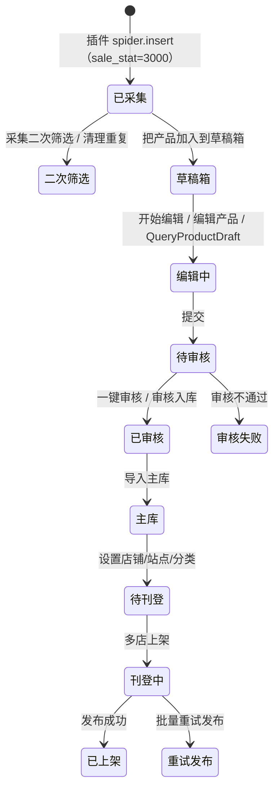

# 02 商品采集库与数据流（最高优先级）

> 核心问题：**浏览器插件采集商品之后，商品数据到底保存在哪里？ERP 客户端如何展示、编辑、管理和使用这些数据？**
> 方法：已有 3 份插件报告复核 + NSIS 非执行式提取 + REA 定向元数据观察；**纯静态，无运行验证**。
> 证据等级：**OBSERVED** / **INFERRED** / **UNKNOWN** / **RUNTIME_VERIFIED**（本轮 0 条）。

---

## 0. 结论速览（先给答案）

| # | 问题 | 结论 | 等级 |
|---|---|---|---|
| 1 | 插件与 EXE 是否直接通信？ | **否。** 插件 POST 到 `seller.zying.net/api`；安装包/程序集中未发现插件↔EXE 的本地 IPC、命名管道、本地 HTTP 服务或消息端口 | **OBSERVED**（未发现）+ **INFERRED**（结论） |
| 2 | 数据先进入云端还是本地 DB？ | **先进入智赢云端服务**；EXE 内 **未发现** 本地商品数据库引擎或商品表结构 | **INFERRED**（高置信） |
| 3 | 客户端怎么拿到采集库？ | 通过 `ZYing.ZClient`（加密长连接 RPC）/ `ZYing.Web.Zrpc<T>` / `HttpClientEx` 向服务端请求，结果以 `Record` 载入 UI | **OBSERVED**（通信类）+ **INFERRED**（业务用途） |
| 4 | 本地是否缓存商品资料？ | 存在 `KeyValueCache` 内存缓存、`ZYing.IO.Cache` 文件缓存、CEF 浏览器缓存、`.json` 配置；**是否含完整商品资料 UNKNOWN** | **OBSERVED**（机制）/ **UNKNOWN**（内容） |
| 5 | 采集库有哪些功能？ | 列表/明细/任务、筛选搜索、删除、重新采集、重复判断、批量采集、二次筛选、转草稿、审核入库、多店上架 | **OBSERVED**（资源/类型名） |
| 6 | 变体/图片/描述怎么组织？ | `SpData` 把 **图片、详情图、变体组合、SKU/库存、多语言标题/卖点/描述** 分成独立字段 | **OBSERVED**（REA 字段级） |
| 7 | 五点卖点与详细描述是否分开？ | **分开**：`_bullets` 与 `_intros` 并列；`get_Bullet` / `get_Intro` 独立属性；插件侧 `sale_bullet` / `sale_intro` 独立字段 | **OBSERVED** |
| 8 | 采集 → 编辑 → 刊登如何流转？ | 采集库 →（加入草稿箱 / 导入主库 / 审核入库）→ 商品编辑 → 多店上架/刊登 → 平台 API，见 `03` | **INFERRED** |

> **关键纠偏**：任务书要求「不要默认 EXE 一定有采集数据库，也不要默认插件直连 EXE」。本轮证据支持的是 **「云端持有采集库 + 客户端 RPC 读取」**，而 **不是** 「EXE 本地有一个采集数据库」。

---

## 1. 已有插件链路复核（不重复研究）

来源：`分析材料/逆向文档/01_亚马逊商品采集功能分析.md`、`02_插件运行流程.md`、`03_跨境ERP助手_采集链路与对比.md`。



**OBSERVED（已有报告）**：
- 采集在插件本地解析 DOM，不是上传整页 HTML；与之相反，`kuajing-erp-plugin-v3-5x` 走「整页 HTML 上行 + 服务端解析」。
- 提交目标域名为 `seller.zying.net/api`；辅助域 `amazon.zying.net/api`。
- 主链路三步：`spider.check` → `amazon_hub.spider` → `spider.insert`。
- 请求带 WASM 生成签名（**本轮只记录「存在请求签名机制」这一用途，不输出算法、密钥或可复用实现**）。
- 所有插件结论也是静态分析，**不是运行时抓包验证**。

**本轮新增观察**：在 `ZYing.User.dll` / `ZYing.Work.dll` / `ZYing.Core.dll` 的 ASCII 字符串中 **未出现** `spider.insert`、`spider.check`、`amazon_hub.spider`、`CmdHandler` 这些插件侧命令名，也 **未出现** 完整的 `sale_*` 字段集合（仅出现 `sale_status`、`sale_props` 等属于 1688/AliExpress API 的同名前缀字段）。
**INFERRED**：插件与客户端不是同一套代码/同一层协议；插件直接对云端 API 提交，客户端通过自己的 RPC 协议读取业务数据。

### 1.1 插件侧 `sale_*` 数据契约（26 个字段，来自已有报告）

| 分类 | 字段 |
|---|---|
| 状态/权限 | `sale_stat`, `sale_flag`, `sale_level`, `sale_grade`, `sale_loginid` |
| 来源 | `sale_source`, `sale_siteid`, `sale_area`, `sale_buypage`, `sale_buy` |
| 文本 | `sale_title`, `sale_brief`, `sale_intro`, `sale_bullet`, `sale_memo`, `sale_brand` |
| 图片 | `sale_pic`, `sale_imgs` |
| 规格/库存 | `sale_size`, `sale_pair`, `sale_stock`, `sale_num`, `sale_attrs` |
| 金额/物流 | `sale_cost`, `sale_cur`, `sale_weight` |

初始状态示例：`sale_stat: 3000`、`sale_flag: 100`、`sale_level: 10`、`sale_grade: 3`。

---

## 2. 全链路数据流（本轮综合结论）



**边界说明**：
- ① 来自已有插件报告（静态源码），③ ④ ⑥ 是**根据通信类命名与结构推断的业务用途**，未抓包验证。
- ⑤ 客户端自带采集器是**第二条独立采集通路**，不能用来证明「插件直连 EXE」。
- ② 云端库表、字段、是否使用对象存储/缓存中间件，**UNKNOWN**。

---

## 3. 「商品数据到底存在哪里」的证据链

### 3.1 支持「服务端持有」的 OBSERVED 证据

| 证据 | 位置 | 说明 |
|---|---|---|
| `seller.zying.net/api` + `spider.insert` | 已有插件报告 | 插件提交目标是云端 API，不是本机地址 |
| `ZYing.ZClient` | `ZYing.Work.dll`（REA 方法/字段级） | `_tcp` / `_ns` / `_buf` / `_key` / `_serial` / `Command` / `TimeOutMS`；`ConnectAsync` / `Reading` / `GetPost` / `Encrypt` / `Decrypt` / `DoParse` / `PostAsync` ×11 |
| `ZYing.Web.Zrpc\`1` / `Zrpc\`2` / `ZrpcBuilder` / `ZrpcModuleBase` | `ZYing.Work.dll` | `ExecuteAsync` / `ExecuteAsModuleAsync` / `ExecuteAsArrayModuleAsync` / `ExecuteDynamicAsync` / `ZClientPost` |
| `GetServerUrl` / `GetOpApiUrl` / `apiServerUrl` / `SignRequest` / `BuildRequestUrl` | `ZYing.Work.dll` | 服务端地址构造与请求签名 |
| `/ws/api.dll`、`/wsapi` | `ZYing.Work.dll` #US 用户字符串 | 服务端 HTTP 入口路径 |
| `ZYing.Web.Http` / `ZYing.Web.HttpClientEx` | `ZYing.Core.dll`（REA 方法级） | `Get` / `GetByteArrayAsync` / `PostAsync` / `GetStringTimeout` |
| `ZYing.ZClient` 服务端分组字段 | `ZYing.Work.dll` REA 字段页 | 存在中文命名的服务分组，其中含「美客多」「刊登」「速卖通」等（**只记录存在分组这一用途，不输出地址/凭据**） |

### 3.2 反对「本地商品 DB」的 OBSERVED 证据（未发现）

对 5 个主程序集 + 全部 70 个载荷做了定向扫描：

```text
SQLite / sqlite3 / System.Data.SQLite / LiteDB / SqlConnection / .db3 / .sqlite   → 0 命中
本地商品表名 / ORM 映射 / 商品数据库迁移脚本                                      → 0 命中
```

同时，本地存储相关只发现：

| 机制 | REA / 字符串证据 | 用途判断 |
|---|---|---|
| `ZYing.KeyValueCache` | `Create` / `Set` / `GetOrCreate` / `GetOrCreateAsync` / `TryGet` / `Remove` / `Clear` / `TryCleanExpired` / `CacheTime` | 进程内 KV 缓存（带过期） |
| `ZYing.IO.Cache` | `get_Dir` / `CalculateMD5` / `FromFile` / `Save` / `GetImage` / `GetBytesAsync` / `Cleanup` / `PathNormal` | 文件/图片缓存 |
| `JsonConfig\`1` / `AppConfig` / `.json` / `oss.json` | `ZYing.Core.dll` | 配置 |
| `get_UserAppDataPath` / `GetFolderPath` / `SpecialFolder` | `ZYing.User.dll` / `ZYing.UI.dll` | 用户数据目录 |
| `GetCachePath` / `ClearBrowserCache` | `ZYing.Work.dll` | CEF 浏览器缓存 |
| `version.ini` | NSIS 脚本头 | 本地版本标记 |

**INFERRED（高置信）**：采集商品主数据由服务端持久化，EXE 是「富业务客户端 + 服务端数据源」；本地只有配置、内存/文件缓存、浏览器缓存与临时图片。
**UNKNOWN**：本地缓存中是否包含完整商品资料快照、缓存有效期、离线可编辑能力。

### 3.3 「插件 ↔ EXE 本地通道」排查

| 检查项 | 结果 |
|---|---|
| 本地监听端口 / NamedPipe / WebSocket server / IPC | **未发现**明确的服务端实现 |
| `http://127.0.0.1:8888` | `ZYing.Core.dll` #US 中存在该字面量（**OBSERVED**），但无调用上下文，**用途 UNKNOWN**；不能据此断言插件↔EXE 通道 |
| `localhost` | `ZYing.ZClient` 有一个名为 `localhost` 的方法（**OBSERVED**），从命名看是开发/调试环境切换，**用途 UNKNOWN** |
| 插件侧域名 | 全部指向 `seller.zying.net` / `amazon.zying.net`，非 localhost |
| `ClientWebSocket` | 存在于 `ZYing.Work.dll`，上下文与 `PrintWayBill` / `waybillNo` / `printData` 相关 → **INFERRED** 用于面单打印，**不是**采集主链路 |

---

## 4. 任务书 10 个重点问题逐条回答

| # | 问题 | 回答 | 等级 | 依据 |
|---|---|---|---|---|
| 1 | 插件与 EXE 是否直接通信？ | **没有证据支持直连**；插件提交到云端 API，安装包与程序集中无本地 IPC 实现 | **INFERRED** | §3.3 |
| 2 | 先入云端还是本地 DB？ | **先入云端**；EXE 未发现本地商品库 | **INFERRED**（高置信） | §3.1 / §3.2 |
| 3 | 通过哪些模块加载采集库？ | `ZYing.User.dll` 的 `ZYing.Channel.*`（列表）、`ZYing.Detail.*`（明细）、`ZYing.Dialog.*`（操作弹窗）；数据经 `ZYing.Work.dll` 的 `ZClient` / `Zrpc<T>` 与 `ZYing.Core.dll` 的 `HttpClientEx` | **OBSERVED**（模块存在）/ **INFERRED**（具体加载调用） | §5 |
| 4 | 列表/筛选/搜索/删除/重新采集？ | 资源与成员名支持：列表、采集二次筛选、只查标题、清理重复、`DBatchDelete*`、`IsRepeat` / `RemoveRepeat`、采集数据更新、批量重试发布、`SpiderSync` / `SpiderBatch` / `SpiderPage` | **OBSERVED**（能力标识）/ **INFERRED**（交互细节） | §5 |
| 5 | 采集商品保存哪些基础字段？ | 见 `SpData` 字段表（§6）：来源 URL、站点、SKU、卖家/店铺、语言、类目、货币、成本、重量、错误、状态等 | **OBSERVED** | §6 |
| 6 | 变体/图片/价格/SKU 如何关联？ | `Pics` / `DetailImgs` 为 `List<string>`；`Pairs` / `Stocks` / `Size` 为独立变体结构；`SpStock` 有 `Sku` / `Num` / `IsOffline` / `Items`；`SpThumb` 有 `Title` / `Url` / `Image` | **OBSERVED** | §6 |
| 7 | 普通描述与五点卖点如何分别保存？ | `_intros` / `get_Intro` 与 `_bullets` / `get_Bullet` 分离，且二者均为**多语言字典**（`class:841`），与 `_titles` / `_keys` 同构；插件侧 `sale_intro` / `sale_bullet` 亦分离 | **OBSERVED** | §6 / §1.1 |
| 8 | 如何从采集库进入编辑页？ | 中文资源出现「开始编辑」「编辑产品」「把产品加入到草稿箱」「修改草稿箱的产品」；类型上有 `ZYing.Detail.Sale` / `ZYing.Detail.Sale_Drop` / `ZYing.Channel.ProductDetail`；方法名 `QueryProductDraft` / `productDraft` / `drafts` | **OBSERVED**（标识）/ **INFERRED**（跳转顺序） | `03` |
| 9 | 采集/编辑/待刊登/已刊登如何流转？ | 中文状态词链：待审核 → 审核中/审核失败/已审核 → 待刊登 → 刊登中/上架中/发布中 → 已上架/未上架；加「导入主库」「审核入库」 | **INFERRED**（由状态词与操作名拼接，无状态枚举实现证据） | §7 |
| 10 | 本地缓存是否保存部分商品资料？ | 存在缓存机制，**但是否含商品资料 UNKNOWN** | **OBSERVED** + **UNKNOWN** | §3.2 |

---

## 5. 采集库 UI 能力索引（`ZYing.User.dll`）

### 5.1 页面与类型

| 命名空间 | 数量 | 与采集库相关的类型 |
|---|---:|---|
| `ZYing.Channel.*` | 64 | `ProductList`、`ProductDetail`、`Meli`、`MeliLogList`、`MeliLocalLogList`、`EMarketSale`、`CTablePanel`、`CGridPanel`、`Buy1688` |
| `ZYing.Detail.*` | 55 | `Sale`、`Sale_Drop`、`Meli`、`MeliLocalLogDetail`、`EVFollow`（跟卖变体）、`Order`、`TraderEdit` |
| `ZYing.Dialog.*` | 53 | `DKindMeli`、`DMeli`、`DMeliBatchDelete`、`DImage`、`DContrast`、`CefBroswerForm`、`DBatchDelete*` |
| 其他 | — | `SpiderSale`、`SpiderItem`、`SpiderBase`、`BulletTemplate`、`SalePic`、`SaleTran`、`SaleBrand`、`TrackSale`、`SpiderBatch` / `SpiderPage` / `SpiderSync` |

### 5.2 功能清单（中文资源字符串，OBSERVED）

**列表与筛选**
`亚马逊采集产品列表`、`亚马逊采集产品明细`、`亚马逊采集任务列表`、`亚马逊采集任务明细`、`采集列表`、`采集二次筛选`、`采集来源`、`采集设置`、`选品列表`、`只查标题`、`只看自己店铺`、`采集分类`、`采集分类对照`、`采集产品黑名单`。

**采集动作**
`单个采集`、`批量采集`、`采集单个`、`开始采集`、`采集批量数据`、`采集数据更新`、`跟卖批量采集`、`跟卖批量采集历史`、`采集失败`、`采集产品批量跟卖`、`采集变体替换`、`补充变体`。

**重复与审核**
`检查详细页重复`、`清理重复`、`IsRepeat` / `RemoveRepeat`、`一键审核`、`审核入库`、`待审核`、`刷新审核`、`刷新审核表`、`产品为审核状态`、`导入主库`、`把产品加入到草稿箱`、`修改草稿箱的产品`。

**图片与变体**
`产品图片`、`产品图片导入`、`图片差异处理`、`替换变体图片`、`清空图片`、`上传图片`、`原图片`、`图片目录`、`变体对照`、`变体字典`、`变体映射列表`、`设置变体`、`统计变体数量`、`跳过相同变体`、`替换变体词`。

> **注意**：`ZYing.User.dll`（17.7 MB）超出 REA 64 MiB 元数据表示预算，`inspect_managed_members` 返回 `coverage.state = unavailable`。因此以上为**资源/类型/名称级证据**，不能给出「按钮 A 调用方法 B」的方法级调用链，该部分标记 **INFERRED / UNKNOWN**。

---

## 6. 商品采集数据模型（REA 字段级 OBSERVED）

来源：`mcp__rea__inspect_managed_members` + `inspect_analysis_view`（`ZYing.Work.dll`，`ev_d9e31272…`，fields 100 条 / methods 139 条全部页读）。

### 6.1 `ZYing.Crawl.SpData` 字段

| 字段 | 签名类型 | 归属 |
|---|---|---|
| `Url`, `Source`, `Origin`, `Area`, `Sku`, `Seller`, `Shop`, `ShopUrl`, `Lan`, `Cur`, `Error`, `VideoUrl` | `string` | 来源与标识 |
| `SaleId`, `SiteID`, `Buys`, `Delay`, `Weight` | `i4` | 编号/计数 |
| `CateId` | `i8` | 类目 |
| `Cost` | `valuetype:257`（十进制数值） | 成本/价格 |
| `Size` | `i4[]` | 变体维度 |
| `_titles`, `_keys`, `_bullets`, `_intros` | `class:841`（同构的多语言容器） | **多语言文本** |
| `Pics`, `DetailImgs` | `List<string>` | **主图 / 详情图分离** |
| `Pairs`, `Stocks` | `class:701` / `class:261` | **变体组合 / 库存** |
| `WAttr` | `class:2137` | 属性 |
| `ReplacePair`, `IsOffline` | `bool` | 状态 |

### 6.2 `ZYing.Crawl.SpData` 方法（节选）

```text
get_Title / set_Title        string
get_Keys  / set_Keys         string
get_Bullet / set_Bullet      string      ← 五点卖点
get_Intro  / set_Intro       string      ← 普通详细描述
GetAllLangs()                Set/Collection<string>   ← 多语言枚举
CheckValid()                 string      ← 采集结果校验
ToBrief()                    string      ← 摘要（对应插件 sale_brief）
ToRecord()                   Record      ← 转为可上行/可存储的记录
KeepPics()                   void        ← 图片保留/清理
```

### 6.3 关联类型

| 类型 | 字段 / 方法 | 说明 |
|---|---|---|
| `ZYing.Crawl.SpThumb` | `Title`, `Url`, `Image` | 缩略图/图片对象 |
| `ZYing.Crawl.SpStock` | `Sku`, `Num`, `IsOffline`, `Items` | **单个 SKU 变体的库存** |
| `ZYing.Crawl.SpiderBase` | `Site`, `Browser`, `_url`, `_src`, `_content`, `_links`；`GetHtmlAsync`, `GetCookies`, `GetData`, `GetStock`, `FetchText`, `EvaluateScriptAsPromiseAsync` | 客户端内置 CEF 采集器 |

### 6.4 插件 `sale_*` ↔ 客户端 `SpData` 对照（**INFERRED**）

| 插件提交字段 | 客户端结构 | 说明 |
|---|---|---|
| `sale_source`, `sale_siteid` | `SpData.Url` / `Source` / `SiteID` | 来源与站点 |
| `sale_title`, `sale_brief` | `_titles` / `ToBrief()` | 标题（多语言）与摘要 |
| `sale_intro` | `_intros` / `get_Intro` | 普通详细描述 |
| `sale_bullet` | `_bullets` / `get_Bullet` | 五点卖点 |
| `sale_pic`, `sale_imgs` | `Pics`, `DetailImgs`, `SpThumb` | 图片（多集合） |
| `sale_pair`, `sale_size`, `sale_stock`, `sale_num` | `Pairs`, `Stocks`, `Size`, `SpStock.Sku/Num` | 变体与库存 |
| `sale_attrs` | `WAttr` | 属性 |
| `sale_cost`, `sale_cur` | `Cost`, `Cur` | 金额与币种 |
| `sale_weight` | `Weight` | 重量 |
| `sale_area`, `sale_buypage`, `sale_buy` | `Area`, `Buys`, `Origin` | 区域与采购信息 |
| `sale_stat`, `sale_flag`, `sale_level`, `sale_grade` | **UNKNOWN** | 状态字段未在 `SpData` 中出现，可能在服务端记录中 |

> **不可越界**：两侧命名与层次不同（插件是扁平 `sale_*` 表单，客户端是强类型对象），此表是**语义对照**，不是「字段名一一对应」的证明；`ToRecord()` 的目标 `Record` 类型未在 `ZYing.Core.dll` 中以 `ZYing.Record` 命中（REA 报告 `unmatched_type_names: ["ZYing.Record"]`），故 **UNKNOWN**。

### 6.5 五点卖点 / 描述 / 图片 / 变体的设计结论

**OBSERVED**：
1. 描述与卖点是**两个同构的独立多语言容器**（`_intros` / `_bullets`），不是把一个字段拆成两条。
2. 主图与详情图是**两个独立 `List<string>`**（`Pics` / `DetailImgs`），另有 `SpThumb` 承载标题/URL/图片数据。
3. 变体维度 `Size`、`Pairs`、`Stocks` 分离；每个 `SpStock` 绑定 `Sku` / `Num` / `IsOffline`。
4. 存在 `Error` 字段与 `CheckValid()`：采集结果可携带校验错误信息。
5. `GetAllLangs()` 表明标题/关键词/卖点/描述按语言组织，对 Mercado Libre MLM/MLB/MLA 多语言场景有参考价值。

**INFERRED**：图片以 URL 集合为主，二进制由独立图片服务/对象存储承载（`ZYing.Core.dll` 中 `ImageURL` / `ImageBase64` / OSS 域名、`Drafts` / `ProductData` 等标识），而非塞进商品记录。

---

## 7. 状态流转（INFERRED）



状态词全部来自 `ZYing.User.dll` / `ZYing.Work.dll` 中文资源：`待审核`、`审核中`、`审核失败`、`已审核`、`产品为审核状态`、`待刊登`、`刊登中`、`上架中`、`发布中`、`已上架`、`未上架`、`采集失败`。
**UNKNOWN**：没有拿到状态枚举定义或数据库字段，无法确认状态值、转换条件、是否可回退。

---

## 8. 第二条采集通路：客户端自带 CEF 采集器

**OBSERVED**：`ZYing.Work.dll` 的 `ZYing.Crawl.SpiderBase` 提供 `Create(url)`、`GetHtmlAsync()`、`GetCookies()`、`EvaluateScriptAsPromiseAsync()`、`GetData()`、`GetStock()`、`FetchText()`，并持有 `Browser` 对象；`ZYing.Work.dll` 引用 CefSharp；`ZYing.User.dll` 有 `SpiderBatch` / `SpiderPage` / `SpiderSync` / `SpiderItem` / `SpiderSale` 及「超级采集器」「采集二次筛选」资源。

**INFERRED**：除浏览器插件外，EXE 自身也能用内嵌 Chromium 打开商品页、执行 JS、解析出 `SpData` 并 `ToRecord()` 后上行云端；两者共用服务端采集库，但是**互相独立的两个入口**。
**重要**：这条通路**不能**被解释为「插件直连 EXE」，也不能据此推断插件数据先落本地。

---

## 9. 本报告的 UNKNOWN 清单

1. 云端采集库的库表、字段、索引、图片存储方式。
2. `spider.insert` 的成功响应体与失败语义。
3. EXE 读取采集库时调用的 RPC 命令名、请求/响应结构。
4. `ZYing.ZClient` 的帧格式、加密方式与命令集合（**只记录存在，不复现**）。
5. 本地缓存是否包含完整商品资料、过期与离线策略。
6. `ZYing.User.dll` 的方法级调用链（REA 预算限制）。
7. `http://127.0.0.1:8888` 与 `ZClient.localhost` 的确切用途。
8. 采集状态枚举值与流转条件。
9. 重复判断的具体规则（URL / ASIN / 标题 / 详情页？）。

详见 `06_证据索引与未确认项.md`。
