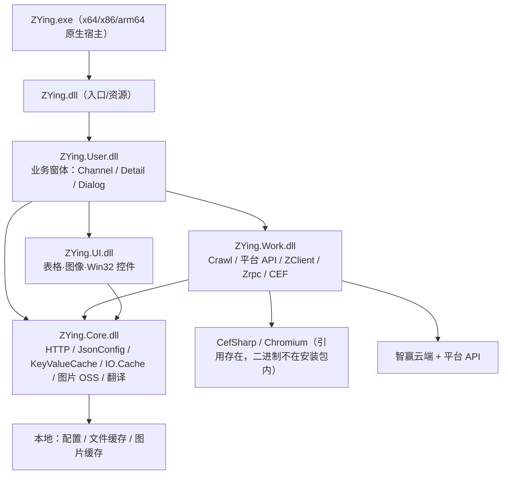
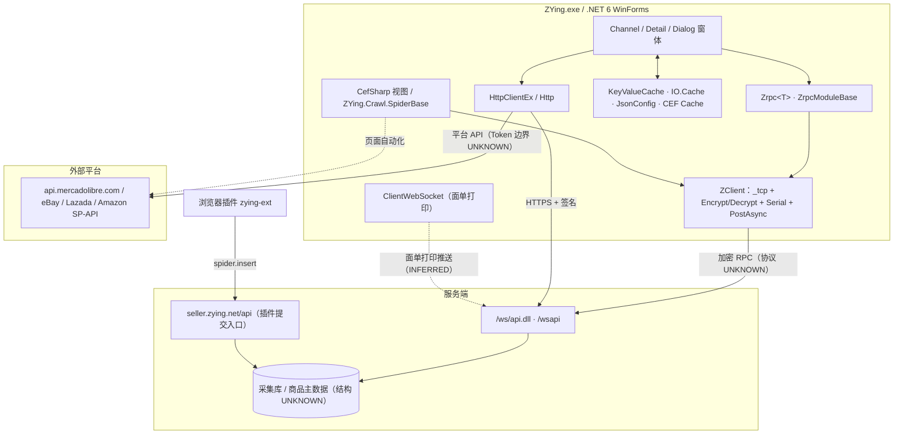

# 04 客户端模块与通信架构

> 重点：页面组织、本地配置/缓存、客户端 ↔ 服务端通信路径、状态管理与错误处理、Tauri 2 可迁移性。
> REA 证据：`ZYing.Work.dll`（`ev_d9e31272…`）、`ZYing.Core.dll`（`ev_c4f04001…`）、`ZYing.User.dll`（`ev_80ae4158…`，预算受限）。
> 全部静态；**RUNTIME_VERIFIED = 0 条**。

---

## 0. 结论速览

| # | 结论 | 等级 |
|---|---|---|
| 1 | 客户端分层清晰：`ZYing.dll`（入口）→ `Core`（基础）→ `UI`（控件）→ `User`（业务窗体）→ `Work`（平台/爬虫/通信） | **OBSERVED** |
| 2 | 页面组织是 `Channel.*`（列表）/ `Detail.*`（明细）/ `Dialog.*`（弹窗）三级 WinForms 结构，混合 CefSharp 浏览器视图 | **OBSERVED** |
| 3 | 主通信是 **自定义加密长连接 RPC（`ZYing.ZClient`）+ 泛型 RPC 封装（`ZYing.Web.Zrpc<T>`）**，辅以 HTTP（`HttpClientEx`、`/ws/api.dll`、`/wsapi`） | **OBSERVED**（组件）/ **INFERRED**（主次） |
| 4 | 存在 `ClientWebSocket`，上下文与面单打印相关，**不是采集主链路** | **OBSERVED** + **INFERRED** |
| 5 | 未发现插件 ↔ EXE 的本地 IPC；`127.0.0.1:8888` 字面量用途 UNKNOWN | **OBSERVED**（未发现）/ **UNKNOWN** |
| 6 | 请求生命周期与 UI loading/error 状态在 `ZClient` 内部绑定 | **OBSERVED**（字段/方法）/ **INFERRED**（行为） |
| 7 | 本地只有配置、KV 缓存、文件/图片缓存、CEF 缓存，**无本地商品数据库** | **OBSERVED**（机制）/ **INFERRED**（结论） |
| 8 | Tauri 2 + React 可独立实现等价的采集库 UI；应替换为标准 HTTPS/JSON，不复制私有 RPC | **INFERRED**（设计建议） |

---

## 1. 程序集分层与页面组织



### 1.1 命名空间与页面层级

| 命名空间 | 类型数（字符串去重估计） | 代表类型 | 作用 |
|---|---:|---|---|
| `ZYing.Channel.*` | 64 | `ProductList`、`ProductDetail`、`Meli`、`MeliLogList`、`CTablePanel`、`CGridPanel` | 列表 / 渠道主页面 |
| `ZYing.Detail.*` | 55 | `Sale`、`Sale_Drop`、`Meli`、`Order`、`EVFollow` | 明细页面 |
| `ZYing.Dialog.*` | 53 | `DImage`、`DKindMeli`、`CefBroswerForm`、`DBatchDelete*` | 操作弹窗 |
| `ZYing.UI.*` / `ZYing.DWin.*` / `ZYing.MainForm` | 少量 | `EBrowser`、`Explorer` | 控件与外壳 |

**OBSERVED**：`ZYing.Work.dll` 中 `ZYing.UI.EBrowser.SendCommand`、`ZYing.UI.Explorer.SendCommand` 是 CEF 视图向页面发命令的入口；`CefSharp.IResponseFilter.InitFilter/Filter`、`ResourceRequestHandler` 说明存在响应拦截/过滤能力（**用途 UNKNOWN**，不推断为绕过机制）。

### 1.2 订单与客服模块（仅初步定位，不深入）

| 模块 | 索引 | 等级 |
|---|---|---|
| 订单 | `ZYing.Detail.Order`、`ZYing.Detail.OP*`（`OPB2W` / `OPHepsi` / `OPLazada` / `OPOzon` / `OPShopify` / `OPTikTok`）、`根据订单列表获取订单详情`、`虾皮买手订单详情`、`QueryOrderReq` / `QueryOrder` / `OrderQueryRsp` | **OBSERVED** |
| 客服/消息 | `ZYing.Dialog.DMail`、`DReply`、`DRepair`、`DRole`、`DReply`、`ZYing.Detail.MsgItem`、`ZYing.Detail.LzdMsgItem`、`ZYing.Web.Mail`（POP3/IMAP） | **OBSERVED** |
| 物流/面单 | `PrintWayBill`、`waybillNo`、`printData`、`/cgi-bin/EmsData.dll?DoApp`、`http://shipping.ems.com.cn/partner/api/public/p` | **OBSERVED** |

> 按任务书要求只做文件/类型索引，未展开调用链、未分析财务/充值/授权模块。

---

## 2. 通信架构（本轮最强的方法级证据）

### 2.1 `ZYing.ZClient`（`ZYing.Work.dll`，REA 139 方法 / 100 字段页读）

**字段（节选，OBSERVED）**

```text
_tcp : class:1017          _ns  : class:1021        _buf / _tmp / _mhead : byte[]
_key : byte[]              _serial : i4            _headerCount : u1      _busy : bool
Command : string           UUID / Name / Tag / Index / ActiveTime / MethodType / Ticks / Total
Server : class:3004        Begin / Receiving / Failed / Finish : 回调集合
PercentUpload / AutoCollect / IsActive / TimeOutMS / Closing
中文命名的服务分组字段：含「美客多」「刊登」「速卖通」「网站」「香港」等（只记录存在分组）
```

**方法（节选，OBSERVED）**

```text
Init(byte[], int)                    ConnectAsync(byte[], int)        Reading(int)
GetPost(byte[])                      NameValuesToBytes(...)           WriteNameValues(...)
Encrypt(byte[]) / Decrypt(byte[])    DoParse(byte[])                  DoReceiving(string)
SetSerial() / ThrowNotMatch()        CheckMethodType()                SetGroup(group)
PostAsync(...)  × 11 重载            get_Busy / get_Serial / get_IsActive
get_Result : i8    get_IsErr : bool    get_Message : string    get_RS : class:385
get_Item(string) : Record            Contains(string) : bool  Throw()
get_UI / get_Loader / get_Button / set_Loading(bool)
DoError(...) / ShowErr(...) / DoHeader() / DoFinish() / OnFinish() / GCollect()
Reset() / Close() / CloseAll() / Expired(int) / CheckExpired()
localhost() / zeyuan() / get_工作区()
```

**判定**：
- **OBSERVED**：存在 `_tcp` 长连接、字节帧缓冲、加密/解密、序列号、命令字符串、超时、异步 Post 多路重载、结果码与错误对象。
- **INFERRED**：这是一套自定义二进制 RPC（长连接 + 请求/响应匹配 + 加密载荷），不是普通 REST；业务模块通过它读写云端数据。
- **INFERRED**：`Result(i8)` / `IsErr` / `Message` / `Throw()` 构成统一错误模型；`UI` / `Loader` / `Button` / `Loading` 把请求状态直接绑定到界面控件。
- **UNKNOWN**：帧格式、加密算法、命令名清单、端口、服务端地址。**按任务书要求不输出密钥/算法/私有协议实现，不尝试复用。**

### 2.2 `ZYing.Web.Zrpc<T>` 泛型 RPC 封装（`ZYing.Work.dll`）

```text
Zrpc`1 / Zrpc`2 / ZrpcBuilder / ZrpcModuleBase
ExecuteAsync                ExecuteDynamicAsync
ExecuteAsModuleAsync         ExecuteAsArrayModuleAsync
ZClientPost                  （异步状态机 <ZClientPost>d__13）
```

**INFERRED**：`ZrpcModuleBase` 是业务模块基类，`Zrpc<T>` 把 `ZClient.PostAsync` 包装成强类型请求/响应，`ExecuteAsArrayModuleAsync` 对应列表结果——与「采集库列表」这类分页数据读取相符（**具体命令名 UNKNOWN**）。

### 2.3 HTTP 层

| 组件 | 位置 | 证据 |
|---|---|---|
| `ZYing.Web.HttpClientEx` | `ZYing.Core.dll` | `get_Instance`、`Create(int)`、`Get`、`GetValue`、`GetByteArrayAsync` ×3、`PostAsync` ×2、`GetStringTimeout`、`CopyStreamTimeout`、`Clone` |
| `ZYing.Web.Http` | `ZYing.Core.dll` | `PostAsync` / `ConnectAsync` 状态机、`SendCommand` |
| 地址构造 | `ZYing.Work.dll` | `GetServerUrl`、`GetOpApiUrl`、`apiServerUrl`、`SignRequest`、`BuildRequestUrl` |
| 入口路径 | `ZYing.Work.dll` #US | `/ws/api.dll`、`/wsapi` |
| 外部平台 | `ZYing.Work.dll` #US | `https://api.mercadolibre.com`、`https://api.ebay.com`、`https://api.lazada.com/rest`、`https://auth.ebay.com/oauth2/authorize`、`https://seller.zying.net/amazon/authback` |
| 通用头 | `ZYing.Work.dll` #US | `X-Api-Key`（仅记录头名称，不输出任何值） |

REA `ZYing.Core.dll` 选中类型的 #US 用户字符串（15 条）还显示：`cache`、`http://`、`https://`、`.jpg?x-oss-process=style/tiny`、`.160`、`图片文件没找到！`、`User-Agent` / `Accept-Encoding` 等——指向**图片缓存与 OSS 缩略图处理**。

### 2.4 WebSocket

**OBSERVED**：`ZYing.Work.dll` 存在 `ClientWebSocket`，相邻上下文为 `PrintWayBill` / `waybillNo` / `printData`。
**INFERRED**：用于面单打印等推送场景，**不是采集库主链路**。
**UNKNOWN**：连接地址、是否复用于业务推送。

### 2.5 IPC / 本地服务排查

| 项 | 结果 |
|---|---|
| 命名管道 / 本地监听服务 / 插件消息端口 | **未发现**明确实现 |
| `http://127.0.0.1:8888` | `ZYing.Core.dll` #US 字面量（**OBSERVED**），用途 **UNKNOWN** |
| `ZClient.localhost()` | 方法名（**OBSERVED**），疑为开发/调试切换，用途 **UNKNOWN** |
| 插件侧目标 | 全部为云端域名（已有插件报告） |

**INFERRED**：插件与 EXE 之间不存在直接本地通道；两者通过云端服务间接协作。

---

## 3. 请求 / 响应结构与错误处理

| 层 | OBSERVED 证据 | 判断 |
|---|---|---|
| 请求载体 | `ZClient.PostAsync` 重载接受 `Record` / `Record[]` / `NameValues` / `string` / `byte[]` / `(string,bool)` / `(string,i4)` / `(string,i8)` / `(string,decimal)` / `(string,string)` | 入参形态多样，支持单条/批量/键值/原始字节 |
| 响应载体 | `get_Item(string) : Record`、`get_RS`、`Contains(string)`、`get_Result : i8`、`get_Message : string` | 具备按名取值的结果容器 |
| 错误 | `get_IsErr`、`Throw()`、`ThrowNotMatch()`、`DoError`、`ShowErr`、`Failed` 回调集合 | 统一错误抛出 + UI 提示 |
| 超时/生命周期 | `TimeOutMS`、`get_Busy`、`get_IsActive`、`Closing`、`DoFinish` / `OnFinish` / `Finish` / `Begin` / `Receiving`、`GCollect` | 请求有明确生命周期与回收 |
| 采集结果校验 | `SpData.CheckValid() : string`、`SpData.Error : string` | 采集层自带字段校验与错误文本 |
| 业务错误文本 | `采集失败`、`审核失败`、`审核不通过`、`国家选择器打开失败`、`没有找到编辑按钮`、`暂不支持该国家：` | 面向用户的可读错误 |
| 进度 | `PercentUpload`、`AutoCollect`、`Total`、`Loading` | 批量/上传进度 |

**INFERRED**：整体是「请求对象 → 异步 Post → 回调更新 UI（loading / 进度 / 成功 / 失败）」的模式；`ZClient` 把网络状态与 WinForms 控件耦合在一起，这在 Tauri + React 中应由独立的 API client + 请求状态层替代。

---

## 4. 本地配置、缓存与状态管理

### 4.1 本地存储（REA 方法级 OBSERVED）

**`ZYing.KeyValueCache`（`ZYing.Core.dll`）**

```text
Create() / Create(string) / Set(...) / GetOrCreate(...) / GetOrCreateAsync(...)
Get(object) / TryGet(...) / TryAdd(...) / Remove(...) / Clear() / Clear(string)
TryGetValue(...) / TryRemove(...) / TryCleanExpired()
```
→ 带过期时间的**进程内 KV 缓存**；`CacheTime` / `CacheKey` / `CacheValue` 字符串佐证。

**`ZYing.IO.Cache`（`ZYing.Core.dll`）**

```text
Deserialize(byte[]) / Serialize(object) / get_Dir()
Cleanup(string,int) / PathNormal(string) / NameFormat(string) / NormalFile(string)
CalculateMD5(byte[]) / FromFile(string,bool) / FromFileAsync / From / FromMagic
Save(...) / ReadAll / ReadAsync / GetImage / GetBytes / GetBytesAsync / ReadAllBytesAsync
```
→ **基于文件 + MD5 命名的磁盘缓存**，明显面向图片/二进制资源。

**其他**：`JsonConfig\`1`、`AppConfig`、`.json` / `oss.json`、`get_UserAppDataPath`、`GetFolderPath(SpecialFolder)`、`GetCachePath` / `ClearBrowserCache`、`version.ini`。

### 4.2 状态管理

| 观察 | 证据 | 等级 |
|---|---|---|
| 请求状态绑定 UI | `ZClient` 的 `UI` / `Loader` / `Button` / `Loading` / `IsActive` / `Busy` | **OBSERVED**（字段）/ **INFERRED**（机制） |
| 业务页异步命令 | `ZYing.User.dll` 中大量 `<doCommand>d__*` / `<DoCommand>d__*` 异步状态机 | **OBSERVED** |
| 视图命令 | `ZYing.UI.EBrowser.SendCommand`、`ZYing.UI.Explorer.SendCommand` | **OBSERVED** |
| RPC 模块基类 | `ZrpcModuleBase`、`SetGroup` | **OBSERVED** / **INFERRED** |

**UNKNOWN**：是否有集中式 store、页面间如何传参、断线重连与离线队列策略。

---

## 5. 通信总览（Mermaid）



---

## 6. 迁移到 Tauri 2 + React 的对应关系

| 智赢实现 | 是否可共用 | Una Seller 的独立实现建议 |
|---|---|---|
| WinForms `Channel/Detail/Dialog` 三级窗体 | 概念可借鉴，代码不可复用 | React 路由 + 采集库列表页 / 详情页 / 少量 Modal，沿用 `ERP-MVP.md` 的 4 个首版菜单 |
| `ZClient` 自定义加密二进制 RPC | **不采用** | 标准 HTTPS + JSON（`/api/v1/collections` 等），用统一 API client + TanStack Query 管理 loading/error |
| `ZrpcModuleBase` 模块基类 | **不采用** | 按业务域拆 hooks / service 模块即可；首版不引入 RPC 框架 |
| `KeyValueCache` / `IO.Cache` | 思路可借鉴 | 首版只保留来源图片 URL；确有离线需求再按 `FOUNDATION.md` 引入 SQLite |
| `SpData.Pics / DetailImgs / Pairs / Stocks / _bullets / _intros` | **数据契约要求可借鉴** | 映射为 `source_products` / `source_product_images` / `source_product_variants`，字段与 DTO 独立设计 |
| `ZClient` 的 UI/Loading 绑定 | 思路可借鉴 | React Query `isPending / isError / error`，与 UI 解耦 |
| 客户端内置 CEF 采集器 + 平台 API 直连 | **不采用** | 采集只在插件侧人工触发；平台 Token 只在后端（`FOUNDATION.md` 强制） |
| `ClientWebSocket` 面单打印 | 首版不做 | 未来如需推送再用标准 WebSocket |
| Windows 专属 Win32 控件消息 / MSHTML | **不采用** | Tauri 2 跨平台 WebView2 / WKWebView，Rust 只做系统能力 |

**OBSERVED 的跨平台障碍**：`ZYing.UI.dll` 含 `LVM_GETITEMTEXTA` / `LVM_SETITEMTEXTA` 等 Win32 消息、`SHGetFolderPath` / `advapi32.dll` / `crypt32.dll`；`ZYing.runtimeconfig.json` 依赖 `Microsoft.WindowsDesktop.App`。
**INFERRED**：这套 UI 与 Windows 强绑定，无法直接迁移到 macOS；但**功能与数据契约**可以在 Tauri 中独立实现，这也是 `FOUNDATION.md` 已经选定的路线。

---

## 7. 工具限制与 UNKNOWN

| 项 | 说明 |
|---|---|
| `ZYing.User.dll` REA 成员级不可用 | `Managed metadata exceeds the 67108864 byte representation budget`，`coverage.state = unavailable`（`ev_80ae4158…`） |
| `ZYing.Work.dll` 元数据 partial | `Module` / `Assembly` 表各 2 行、`#GUID` 堆索引越界；类型/方法观察有效但不宣称全量 |
| `ZYing.Core.dll` 元数据 complete | MVID `2d0b341e-98cf-4524-b5a1-12275bcde80a`，选中 3 类型 67 方法 / 20 字段 / 15 用户字符串 |
| `ZYing.Record` 未命中 | REA 报告 `unmatched_type_names: ["ZYing.Record"]`，`ToRecord()` 返回类型所在程序集 **UNKNOWN** |
| 无运行验证 | RPC 命令名、响应体、端口、加密方式、缓存内容、WebSocket 用途全部 **UNKNOWN** |
