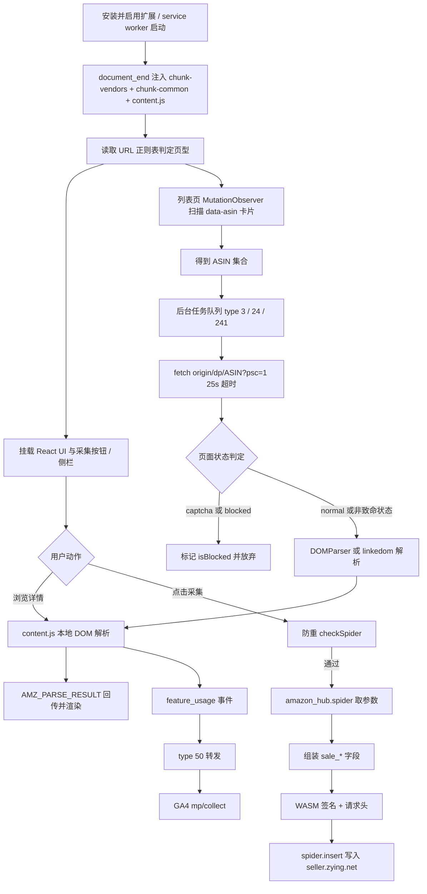
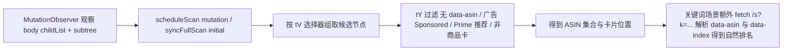
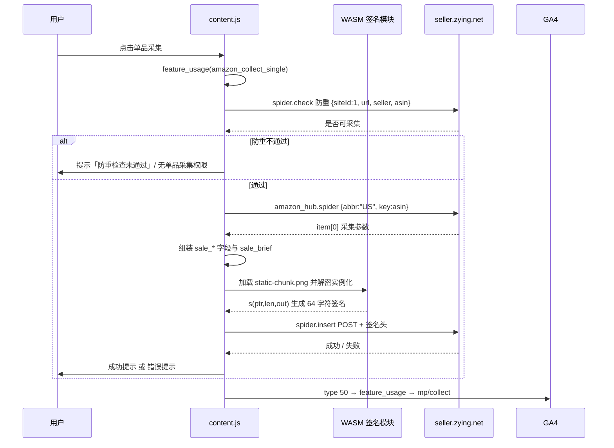
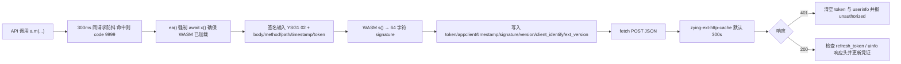
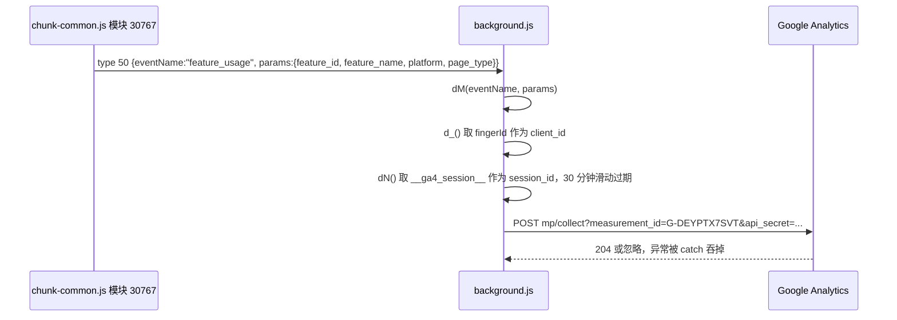

# 智赢插件（zying-ext 5.2.0）在 amazon.com 的运行流程

> 配套文档：`01_亚马逊商品采集功能分析.md`（字段/接口/证据）、`03_跨境ERP助手_采集链路与对比.md`
> 本文描述**静态代码所表达的运行流程**，不是运行时抓包验证结果。所有分支以源码中的条件为准。

---

## 0. 一图流



---

## 1. 阶段 0：扩展启动

| 步骤 | 代码 / 配置 | 说明 |
|---|---|---|
| 0.1 | `manifest.json` → `background.service_worker = assets/js/background.js` | MV3 service worker，事件驱动、可能被回收后重启 |
| 0.2 | `permissions` 含 `tabs / storage / cookies / alarms / declarativeNetRequestWithHostAccess` | 为跨标签调度、凭证、动态 DNR 规则做准备 |
| 0.3 | `host_permissions = http://*/* + https://*/*` | 覆盖所有站点，不只 Amazon |
| 0.4 | background 预置 56 个数字消息 handler（1…241），含采集队列与 GA4 转发 | 见 §10 |
| 0.5 | WASM 解密模块（background 模块 7175）按需加载 `assets/img/static-chunk.png`，解密产物缓存到 Cache Storage `zy-sc-v1` | 首次请求签名时才触发；缓存 immutable 1 年 |
| 0.6 | 读取 `fingerId`（chrome.storage，legacy `zying_fingerid`）、`__ga4_session__` | GA4 client_id / session_id |
| 0.7 | `token` / `userinfo` 从本地恢复；401 时清空 | 之后从响应头 `refresh_token` / `uinfo` 刷新 |

---

## 2. 阶段 1：页面注入与页型识别

```
用户打开 https://www.amazon.com/dp/B0XXXXXXXX
        ↓ document_end
注入 chunk-vendors.js → chunk-common.js → content.js（隔离世界）
        ↓
content.js 模块 27589 用 url 正则表匹配 location.href
        ↓
detail / gpdetail / gpdetail2 / search / cate / bsr / newrelease /
moversandshakers / mostwishedfor / mostgifted / bsrPage / ytst …
        ↓
读取站点配置 Qf[host] 或 Qf["amazon.com"]
   → {serverKey:"us", lan:"en", curency:"USD", postCode:[98101,…]}
```

`passkey-inject.js`（`world: MAIN`，`document_start`）**只匹配 Seller Central 域**，在 amazon.com 商品页不会执行。

---

## 3. 阶段 2：UI 挂载

- `content.js` 在内创建 `#mount-point` 容器与全局样式（`#zying-global-style-container`），渲染 React 组件。
- 挂载的元素包括：单品「采集到智赢」按钮、侧栏（drawer）、搜索结果卡片角标、`#zying-postcode-append` 邮编提示（监听 `#GLUXZipInputSection` 出现后插入）等。
- `DataFetchManager` / `HostManager` / `AmazonDataDiffMonitor` 初始化；后者把「DOM 结构变化导致字段缺失」作为 `parserWarnings` 上报。
- 各功能触发时调用 `feature_usage({feature_id, feature_name, platform:"amazon", page_type})`。

---

## 4. 阶段 3：列表页 ASIN 发现



- `tV` = `.s-result-item.s-asin[data-asin]` + `[class*="_c2Itd_asinContainer_"][data-asin]` + `[data-asin][data-uuid]` / `[data-asin][data-component-id]`。
- 关键词分页：`${origin}/s?k=${kw}&qid=<秒级时间戳>&ref=sr_page_{page-1}`，用正则从 HTML 抠 `data-asin="…" data-index="N"` 与 `"1-48 of N results"`。
- 榜单页：`/gp/bestsellers`、`/gp/new-releases`、`/zgbs`、`Best-Sellers-` 等 URL 规则。

---

## 5. 阶段 4：详情数据获取（三条通道）

| 通道 | 触发 | 消息 | 数据来源 |
|---|---|---|---|
| **A. DOM 通道** | 页面已有商品 DOM | `AMZ_PARSE_REQUEST` / `AMZ_PARSE_RESULT`（字符串型消息，带 `messageId`、`data.HTML`、`asin`、`lan`、`site`） | content script 内 `AMZDetailDomParser`（模块 79667 → 22516） |
| **B. 后台单 ASIN 通道** | 需要补数据 / API 模式 | `type 24 (ASINDETAIL)` | background `fetch` 详情 HTML 后解析 |
| **C. 后台批量队列** | 列表页批量 | `type 3 (ASINPARSEITEM)` / `type 241 (ASINSDETAIL)` | `hk.getInstance().scheduleTask(3, params, tab.id, …)` |

`type 3` 的即时响应：

```js
sendResponse({ success: true, accepted: true, type: "ASINPARSEITEM", count: … });
hk.getInstance().scheduleTask(3, e.params, r.tab.id, () => {});
```

`DataFetchManager.fetchBatch()` 会打日志 `[DOM Dispatch] Sending ASINPARSEITEM for …`，并为每个 ASIN 记录 `data_fetch.dom_request_dispatched / acknowledged / failed` 埋点。

---

## 6. 阶段 5：后台 HTML 抓取与页面状态机

```js
requestParams = { url: `${origin}/dp/${asin}?psc=1`, html: e.html },
parser: oy,
cache: { name: "asin", path: lr(asin) }

oH = (url, timeout) => {
  const r = new AbortController();
  const n = timeout && timeout > 0 ? timeout : 25e3;
  return Promise.race([fetch(url, { signal: r.signal }), s]);
};
```

- 若请求消息自带 `html`，**跳过网络抓取**直接解析。
- 结果以 `asin` 为键写入 `asin` 缓存路径。
- 页面状态判定（linkedom 解析器内）：

| 状态 | 判定特征 | 后续 |
|---|---|---|
| `captcha` | `form input[id*=captcha]`、`img#d[alt="Dogs of Amazon"]` | `isBlocked = true`，放弃 |
| `blocked` | `action="/errors/validateCaptcha"`、`opfcaptcha.amazon.com` | `isBlocked = true`，放弃并给出「被亚马逊拦截」提示 |
| `zipRequired` | `Choose your location` / `Select delivery location` / `邮编` / `郵便番号`，且未识别到地址 | 写 `parserWarnings` |
| `deliveryUnavailable` | `cannot be shipped to your selected delivery location` | 写 `parserWarnings` |
| `buyboxMissing` | 无 BuyBox 相关节点 | 写 `parserWarnings` |
| `normal` | BuyBox 等节点齐全 | 正常解析 |
| `unknown` | 以上都不匹配 | 写 `parserWarnings` |

结果对象含 `asin / update / pageState / parserModeUsed:"linkedom" / parserWarnings[]`。

---

## 7. 阶段 6：DOM 字段解析

- **优先**：DOMParser（在 content script 或后台视通道而定）；**兜底**：linkedom。
- 解析结果对象的字段见 `01_…md` §3.3.2（42 + 19 个字段）。
- 每个字段都走「多选择器兜底链」：例如 `title` 有 10 个候选选择器，失败后再尝试从页面脚本 `jQuery.parseJSON('…')` 抠取。
- 图片：`#mainImageContainer img[data-a-dynamic-image]` 的 JSON 按 `宽×高` 选最大图 → `hiRes`；`data-old-hires` / `src` 兜底；排除视频缩略图；汇总 `image / mainPics / allPics`。
- 变体：解析 `#twisterJsInitializer_feature_div` / `#twister_feature_div` / `#softlinesTwister_feature_div` 内嵌脚本的 `dimensionToAsinMap`、`asinVariationValues`、`variationValues`、`variationDisplayLabels`、`numTotalVariations`，产出 `skuLabels / skuValues / skuDisplay / variationsNum / sku / selectSku`。
- 价格：9 个价格选择器兜底 + `input[name*=customerVisiblePrice][value]` + `[data-csa-c-delivery-price]`（运费）。
- 卖家：`#merchant-info` / `#tabular-buybox` / `desktop-merchant-info` 系列 + `input#merchantID` 的 value + `seller=([A-Z0-9]{10,})` 抠 sellerId；`#aod-ingress-link` / `/gp/offer-listing` 拿报价数量。
- BSR/类目：`#SalesRank` 与 `#detailBullets…` 列表的键值解析。
- 环境：`navigator.userAgent` / `mimeTypes` → `brower`、`installFrom`。

---

## 8. 阶段 7：结果回传与前端渲染

```js
f({ type: "AMZ_PARSE_RESULT", messageId, data: parsed, fullUrl: location.href });
// 异常时：
f({ type: "AMZ_PARSE_RESULT", messageId,
    data: { success:false, error:String(err), asin }, fullUrl: location.href });
```

- `finally` 中把 `HTML` 与 `e.data.HTML` 置 `null`，避免大 HTML 常驻内存。
- 前端通过事件总线（`(0,i.Zc)().emit(...)`）刷新 UI，例如 `amazonServerDetailUpdated`。
- `AmazonDataDiffMonitor` 对比服务端详情与页面 DOM，记录 `brandNull / brandR / AMZ / FBA / FBM / priceLength` 等统计，用于发现选择器失效。

---

## 9. 阶段 8：用户点击「采集到智赢」



关键代码：

```js
if (await checkSpider({siteId:1, url:`${location.origin}/dp/${asin}`, seller, asin})) {
  let cfg  = Qf[host] || Qf["amazon.com"];
  let abbr = (cfg.serverKey || "us").toUpperCase();          // "US"
  let d    = await getAsinSpiderParams({abbr, key: asin});
  let c    = d.item?.[0];
  let brief = JSON.stringify({ [lan || "en"]: titleLikeText });
  let p = {
    sale_stat: 3000, sale_flag: 100, sale_level: 10, sale_grade: 3,
    sale_loginid: account.id,
    sale_source: `${location.origin}/dp/${asin}`,
    ...c,
    sale_brief: brief
  };
  await spiderProduct(p);   // POST /CmdHandler?cmd=spider.insert
}
```

`sale_*` 26 个字段见 `01_…md` §3.4。另有一条二次入库：`spiderProduct` 返回 `result` → `spiderInsertProd({ids: result})` → `cmd=spider.ins`。

---

## 10. 阶段 9：网络层（签名、缓存、重试）



- `ext_version` 由 DES-CBC 解密得到；`appclient = "3"`，`version = "v1.1"`。
- WASM 容器校验：`rt_integrity`（off/soft/strict）控制哈希/长度不符的处理；`rt_probe` 检测 `performance.now()` 差值 > 120ms（疑似调试）；失败清 `zy-sc-v1` 缓存并 `cache:"reload"` 重取。

---

## 11. 阶段 10：遥测旁路（与采集并行）



`feature_usage` 事件**不进入采集入库链路**，是独立旁路；64 个功能 ID 中 18 个属于 Amazon。

---

## 12. 消息类型速查（background.js 56 个 handler）

| type | 用途 | type | 用途 |
|---|---|---|---|
| `3` | `ASINPARSEITEM` DOM 采集队列 | `24` | `ASINDETAIL` 单 ASIN 详情 |
| `50` | GA4 事件转发 | `56` | marker 快照 / `reload_marker_snapshot` |
| `241` | `ASINSDETAIL` 批量详情 | `133` | 扩展内部（未展开） |
| `AMZ_PARSE_REQUEST` | 后台 → content，请求 DOM 解析 | `AMZ_PARSE_RESULT` | content → 后台，回传解析结果 |

完整数字集合：`1,3,4,8,10,11,12,13,14,16,17,19,20,21,22,23,24,25,26,27,28,29,30,31,32,33,34,35,36,37,38,39,40,41,42,43,44,45,47,48,49,50,51,52,53,55,56,61,67,68,69,70,71,72,133,241`。

---

## 13. 异常与重试分支总表

| 异常 | 触发条件 | 处理 |
|---|---|---|
| 抓取超时 | `fetch` 超过 25s（可传入自定义 timeout） | `Promise.race` + `AbortController` 放弃 |
| CAPTCHA / 拦截 | 命中 `oc / od` 特征 | `isBlocked=true`，返回中文提示，不入库 |
| 邮编未设置 | `zipRequired` | 只写 `parserWarnings`，前端可插入邮编提示 UI |
| 无法配送 / 无 BuyBox | `deliveryUnavailable` / `buyboxMissing` | 写 `parserWarnings`，字段可能缺失 |
| 解析抛异常 | `AMZDetailDomParser` 抛错 | 回 `{success:false,error,asin}`，控制台 `[ContentJS DOM解析] 解析失败` |
| 防重失败 | `spider.check` 返回 false | 提示「防重检查未通过」或无采集权限 |
| 采集参数失败 | `amazon_hub.spider` 无 `item` | 提示「获取采集参数失败」 |
| 入库失败 | `spiderProduct` 返回假值 | 提示「采集接口未返回成功结果」/「接口保存失败」 |
| 401 | 响应 code/status 401 | 清 `token`/`userinfo`（仅 `/zying\.net/i` 域）并报 unauthorized |
| 重复请求 | 300ms 内同请求 | code `9999` 防抖 |
| WASM 校验失败 | 哈希/长度不符、`rt_integrity=strict` | 抛 `E1097/E1098`，或清 `zy-sc-v1` 后 `cache:reload` 重取 |
| 疑似调试 | `rt_probe=1` 且 `performance.now()` 差值 >120ms | 告警 `E1099` |
| DOM 变更导致字段缺失 | `AmazonDataDiffMonitor` 统计 | 写 `parserWarnings` 用于监控选择器失效 |

---

## 14. 存储与状态位置

| 位置 | 键 / 名称 | 用途 |
|---|---|---|
| `chrome.storage` | `fingerId`、`token`、`userinfo`、`__ga4_session__`、各业务缓存 | 跨会话身份与状态 |
| `localStorage` | `zying_fingerid`（legacy）、`rt_integrity`、`rt_probe` | 指纹兼容、完整性策略、反调试开关 |
| Cache Storage | `zy-sc-v1` | 解密后的 WASM 模块（immutable 1 年） |
| 自建缓存 | `zying-ext-http-cache` | API 响应缓存（默认 300s） |
| 自建缓存 | `asin/{…}`（`lr(asin)`） | ASIN 详情解析结果 |
| 内存 | `DataFetchManager` / `HostManager` / `AmazonDataDiffMonitor` | 队列、锚点观察、DOM 差异统计 |

---

## 15. 与跨境 ERP 助手的流程差异（摘要）

| 阶段 | 智赢 | 跨境ERP助手 |
|---|---|---|
| 启动 | 本地代码即全部逻辑 | 本地 WXT 壳 → `/open/v3/getTs` 取注入规则 → `injected.js` 拉远程 `.vite/manifest.json` → 注入主世界入口 JS |
| 页面识别 | 本地 URL 正则表 | 远程包内 `amazon.*` 匹配 |
| 详情数据 | 本地 DOM 解析成结构化字段 | 直接 `document.documentElement.innerHTML` 整页上行 + `productExtInfo` |
| 变体 | 页面内嵌 twister JSON | 主动调 `/gp/product/ajax/twisterDimensionSlotsDefault`（8 ASIN/批、最多 64）与 `/gp/twister/ajaxv2` |
| 上行 | `spider.insert`（WASM 签名） | `/open/fetch/pfti` → `/open/niu/push_collect_box` 入采集箱 |
| 解析责任 | **客户端** | **服务端** |

详见 `03_跨境ERP助手_采集链路与对比.md`。

---

## 16. 流程描述的边界

- 本文所有流程均由静态源码与 REA 静态图推导，**没有真实运行抓包**。
- REA 的 `request` 语义族在两次分析里 `retained_relations = 0`，`api:fetch` / `channel:AMZ_PARSE_REQUEST` seed 均 `no-match`；因此本文的网络与消息顺序来自源码实读而非 REA 请求图。
- 静态关系不证明运行时执行；`coverage.status = partial`、34/35 个未选文件、语义图 truncated 等限制见 `01_…md` §7.2。
- 服务端返回结构（`spider.insert` 的 `item` 内容、错误码全集）未知，需运行时样本。
