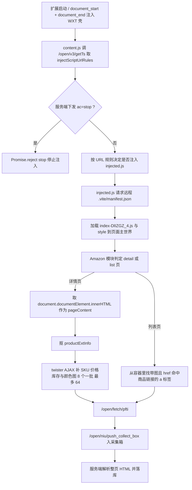

# 跨境ERP助手（kuajing-erp-plugin-v3-5x 5.0.11）采集链路与对比

> **文档性质**：静态逆向分析记录（只读）
> **分析对象**：`C:\Users\ASUS\Downloads\Compressed\kuajing-erp-plugin-v3-5x`（工作区副本：`分析材料/浏览器插件/kuajing-erp-plugin-v3-5x`）
> **配套文档**：`01_亚马逊商品采集功能分析.md`、`02_插件运行流程.md`
> **分析日期**：2026-11-15

---

## 0. 核心结论

**本地包只是壳，真正的 Amazon 采集逻辑是运行时从远程服务器下载的。**

```
本地 WXT 壳 (content.js + injected.js)
   → 从 /open/v3/getTs 取 URL 注入规则
   → injected.js 请求 https://kuajing-plv3.happyporsche.com/.vite/manifest.json
   → 得到入口 main-assets/index-DlIZGZ_4.js (约 1.57 MB)
   → 注入页面主世界执行
   → Amazon 模块把整页 HTML 上行给服务端解析
```

这与智赢「本地 DOM 解析成结构化字段」是相反架构。

---

## 1. 本地包结构

### 1.1 `manifest.json`【源码】

```json
{
  "version": "5.0.11",
  "permissions": ["tabs","storage","scripting","declarativeNetRequest",
                  "webRequest","management","unlimitedStorage","cookies"],
  "host_permissions": ["<all_urls>"],
  "background": { "service_worker": "background.js" },
  "content_scripts": [
    { "matches": ["<all_urls>"], "all_frames": true,
      "run_at": "document_end", "js": ["content-scripts/content.js"] },
    { "matches": ["<all_urls>"], "all_frames": true,
      "run_at": "document_start", "js": ["content-scripts/start.js"] }
  ]
}
```

`all_frames: true` + `<all_urls>` + `document_start` + `cookies`：注入面比智赢更宽。

### 1.2 `env.json`【源码】

```json
{ "d": "{\"releaseChannel\":\"msErp\",\"version\":\"5.0.11\"}", "s": "..." }
```

发布通道 `msErp`。

### 1.3 `rules.json`（DNR 静态规则）【源码】

为 `*.kuajingmaihuo.com` 与 `queryTrace.do?dimension=TRADE_ID` 修改 `Origin` 请求头，属于业务系统跨域适配，**与 Amazon 采集无关**。

### 1.4 `content-scripts/content.js`（WXT 内容脚本壳）【源码】

```js
// 按规则注入本地 injected.js
yh(q.runtime.getURL("/injected.js"), {"data-inject-type": l});

// 从服务端取注入 URL 规则
q_ = async () => {
  let { injectScriptUrlRules } = await q.storage.local.get("injectScriptUrlRules");
  ...
  let a = await xr({ path: "plwFetch",
                     data: [{ url: "/open/v3/getTs", method: "POST", ... }] });
  if (a.ac === "stop") return Promise.reject("stop");   // 服务端可远程关停
  ...
};
```

【推断】远程配置里存在 `inner / blob / inline / eval / documentStart` 等注入策略，由 `data-inject-type` 选择。

### 1.5 `injected.js`（unlisted script loader）【源码】

```js
const e = "https://kuajing-plv3.happyporsche.com";
const n = await contentScriptServiceRequest({
  path: "commonFetch",
  data: { url: `${e}/.vite/manifest.json` }
});
const i = Object.values(n).find(l => l.isEntry && l.name === "index");
css: t.map(l => `${e}/${l}`),
js:  r.map(l => `${e}/${l}`)
```

远端 `/.vite/manifest.json` 实际返回：

```json
{
  "index.ts": { "file": "main-assets/index-DlIZGZ_4.js", "name": "index",
                "src": "index.ts", "isEntry": true },
  "style.css": { "file": "main-assets/style-CQzT56KG.css", "src": "style.css" }
}
```

> **供应链风险**：核心 JS 由 `happyporsche.com` 域随时可替换，且被注入页面**主世界**（可读取页面全局变量、绕过扩展隔离），配合 `<all_urls>` + `cookies` 权限，风险等级高。

---

## 2. 远程核心包中的 Amazon 采集模块

分析时把 `main-assets/index-DlIZGZ_4.js` 下载到本地临时文件（`C:\Users\ASUS\AppData\Local\Temp\kj_index.js`，约 1.57 MB）后静态阅读。

### 2.1 平台常量与页面匹配【源码】

```js
rp = "amazon";
nO = "(?:www|us).amazon.([\\w\\.]+).*/(?:dp|gp/product|gp/aw/d)/(\\w+)";

matches: ["*://*.amazon.com/*", "*://*.amazon.com.au/*", ...],
useAutoCollect: true,
matchDetailPage: aO,
matchListPage: sO
```

详情页 URL 命中 `(dp|gp/product|gp/aw/d)/{ASIN}`；列表页命中 `/s?`、`/b?node=`、`/gp/bestsellers`、`/gp/new-releases`、`/stores/page/`。

### 2.2 详情数据获取：整页 HTML 上行【源码】

```js
getCollectDetailPageDataSourceInfo: async () => {
  const l = location.href;
  let u = document.documentElement.innerHTML;
  const p = {
    pageContent: u,                                  // 整页 HTML 原样
    itemId: "",
    source: rp,                                     // "amazon"
    site: "",
    afterUrl: l,
    productExtInfo: JSON.stringify(await c(u))      // 页面里抠出的补充信息
  };
  const g = mu(l);
  ...
  return p;
}
```

**关键点**：客户端不解析商品字段（标题/价格/BSR 等都在 `pageContent` 里由服务端解析），只做页面 HTML 搬运 + 少量 `productExtInfo`。

### 2.3 列表页：找带图且 href 命中商品链接的 `<a>`【源码】

从 `.s-search-results`、`#zg-right-col`、`.stores-page` 等容器中，找带 `img` 且 `href` 命中 `/dp/`、`/gp/product/`、`/sspa/click?` 的锚点。

### 2.4 变体 / SKU 价格与库存：直接调 Amazon AJAX【源码】

```js
// ① SKU 价格、库存、可用性
Yt({
  url: `https://${location.hostname}/gp/product/ajax/twisterDimensionSlotsDefault`,
  method: "GET", params: r, xhrFields: { responseType: "text" }
});

// ② 颜色图 / altImagesData
Yt({
  url: `https://${location.hostname}/gp/twister/ajaxv2`,
  method: "GET", params: { asinList: e.asin, ...t }
});
```

- 变体参数从页面脚本中抠：`asinVariationValues`、`dimensionValuesDisplayData`、`colorImages`、`colorToAsin`、`twisterUpdateURLAppend.immutableParams`。
- **最多 64 个 ASIN，按 8 个一批并发请求**。

### 2.5 上行接口与采集箱【源码】

```js
// 辅助：产品信息抓取
Aa({ /* ... url: "/open/fetch/pfti", method: "POST" ... */ });

// 入库采集箱
Aa({ url: "/open/niu/push_collect_box", method: "POST", data: e });
```

链路：`setupCollect` → `platformCollectAmazon` → 组装 `pageContent / productExtInfo` → `/open/fetch/pfti` → `/open/niu/push_collect_box`。

---

## 3. 运行流程（远程包视角）



---

## 4. 两个插件完整对比

| 维度 | 智赢 `zying-ext` 5.2.0 | 跨境ERP助手 `kuajing-erp-plugin-v3-5x` 5.0.11 |
|---|---|---|
| 代码位置 | 全部本地打包（36 个相关文件） | 本地 WXT 壳；核心 JS 远程热更新 |
| 远程域 | 业务 API：`seller.zying.net` / `amazon.zying.net` | 代码 CDN：`kuajing-plv3.happyporsche.com`；业务 API：`/open/*` |
| 注入世界 | 隔离世界 content script（`document_end`） | 远程入口脚本注入**页面主世界**（另有 `document_start` 壳） |
| 注入范围 | `http://*/*` + `https://*/*` | `<all_urls>` + `all_frames:true` |
| 权限 | tabs/storage/cookies/alarms/contextMenus/declarativeNetRequestWithHostAccess | 上述 + scripting/webRequest/management/unlimitedStorage |
| 页型识别 | 本地 URL 正则表（detail/gpdetail/search/cate/bsr/newrelease/zgbs…） | 远程包内 `amazon.*` 正则与 `/s?`、`/b?node=`、`/gp/bestsellers`、`/stores/page/` |
| 列表页 | `MutationObserver` + `data-asin` 选择器组 + 广告过滤；关键词排名靠抓 `/s?k=` HTML 正则抠 | 从 `.s-search-results` / `#zg-right-col` / `.stores-page` 找带图商品链接 |
| 详情页字段 | **本地 81 个选择器兜底链**解析 42+19 个字段 | **不解析**，整页 `innerHTML` 作为 `pageContent` 上行 |
| 变体 / 价格 / 库存 | 读页面内嵌 twister JSON（`dimensionToAsinMap` 等） | 主动调 `/gp/product/ajax/twisterDimensionSlotsDefault` + `/gp/twister/ajaxv2`，8 个/批、最多 64 |
| 图片 | `#landingImage` / `data-a-dynamic-image` JSON 解析 hiRes + 附图 | 主要通过 `colorImages` / `altImagesData` 与整页 HTML |
| 卖家 / BSR / 类目 | 本地 `#merchant-info` / `#SalesRank` / `#detailBullets…` 解析 | 交给服务端从 `pageContent` 解析 |
| 上行接口 | `CmdHandler?cmd=spider.check → amazon_hub.spider → spider.insert`，提交 `sale_*` 字段 | `/open/fetch/pfti` → `/open/niu/push_collect_box` 入采集箱 |
| 请求保护 | **加密 WASM 签名**（双上下文内联）+ rt_integrity / rt_probe / `zy-sc-v1` / 300ms 防抖 / 401 清 token | 静态 DNR 规则改 `Origin`；未见等价签名机制 |
| 遥测 | GA4 `measurement_id=G-DEYPTX7SVT`（api_secret 硬编码）+ `feature_usage` 64 项功能埋点 | 未在本次静态分析中确认 |
| 可远程关停 | 未见 | `getTs` 返回 `ac:"stop"` 可停止注入 |
| 主要风险 | 宽 host permissions；隐藏加密 WASM；硬编码 GA4 凭据 | **供应链风险高**：远程主世界脚本 + `<all_urls>` + cookies，服务端可随时更换全部采集逻辑 |

---

## 5. 证据与限制

- 本文结论来自本地包源码实读 + 远程 `/.vite/manifest.json` 与 `main-assets/index-DlIZGZ_4.js` 的下载件静态阅读。
- 远程包内容**随发布随时可能变化**；本文对应分析时抓到的 `index-DlIZGZ_4.js`。
- `content.js` 中的注入策略名（`inner/blob/inline/eval/documentStart`）为【推断】，来自 `data-inject-type` 与规则字段的组合，未做运行时验证。
- `/open/fetch/pfti` 与 `/open/niu/push_collect_box` 的服务端返回结构未知。
- 本插件只做静态分析，未用 REA MCP 深度重建（按本轮任务范围，REA 深挖聚焦智赢）。
- 静态分析不证明运行时执行；`useAutoCollect: true` 表示存在自动采集能力，但具体触发条件需运行时确认。

---

## 6. 文件索引

| 文件 | 作用 |
|---|---|
| `manifest.json` | MV3 权限与两条 content script |
| `env.json` | `releaseChannel: msErp`、版本 5.0.11 |
| `rules.json` | DNR：为 `*.kuajingmaihuo.com` / `queryTrace.do` 改 `Origin` |
| `content-scripts/content.js` | WXT 壳，读取 `injectScriptUrlRules`、调 `/open/v3/getTs`、注入 `injected.js` |
| `content-scripts/start.js` | `document_start` 更早阶段脚本 |
| `injected.js` | unlisted script loader，拉远程 Vite manifest 并注入主世界 |
| `background.js` | service worker，消息/网络代理（`plwFetch` / `commonFetch`） |
| `https://kuajing-plv3.happyporsche.com/.vite/manifest.json` | 远程入口清单 |
| `main-assets/index-DlIZGZ_4.js` | 远程核心包（含 Amazon 采集模块，约 1.57 MB） |
